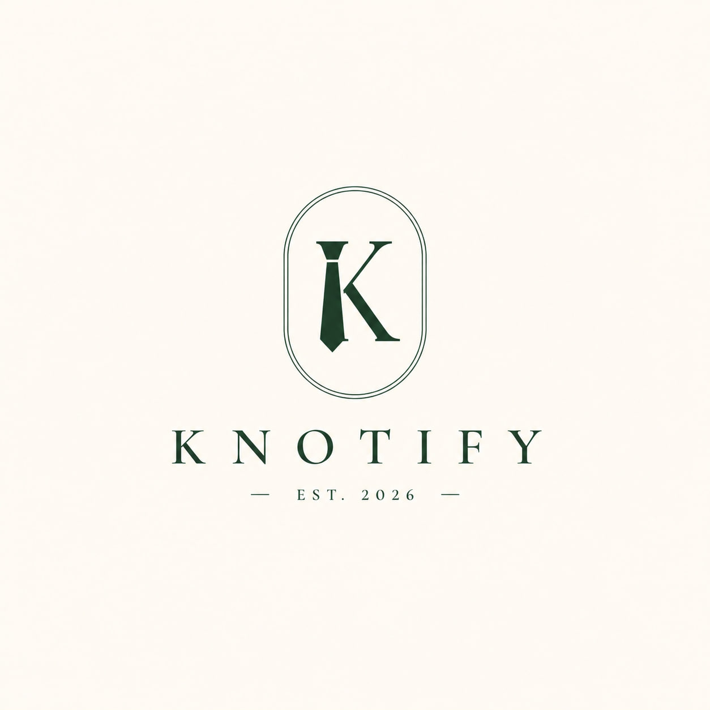

# Knotify: A NeckTie Accessory Ecommerce store for CU Students (for now)

  

---

## What is Knotify?

**Knotify** is a peer-to-peer neckwear marketplace built exclusively for [Covenant University](https://covenantuniversity.edu.ng) students. It solves a very real and recurring problem on campus — students struggling to find affordable, chapel-approved ties quickly, especially during resumption week when demand spikes and time is short.

Instead of scrambling through WhatsApp groups or relying on luck, Knotify gives every CU student a fast, structured way to **buy, reserve, and sell** regulation-compliant neckties directly from fellow students.

---

## The Problem It Solves

Every semester, hundreds of students arrive on campus needing a chapel-compliant tie immediately. The existing options are:

- Overpriced ties from campus stores
- Unreliable WhatsApp group posts with no structure
- Borrowing from friends (which never ends well)

Knotify replaces all of that with a clean, fast, and verified marketplace.

---

## How It Works

1. **Browse** — Students browse a curated catalog of available ties (plain, striped, vintage, corporate) filtered by type and price.
2. **Reserve** — A small deposit is paid online via Flutterwave to lock in the tie.
3. **Pick Up** — The buyer collects the tie at an assigned hall lobby pickup point (e.g. near Daniel, Peter, Esther, or Lydia Hall) and pays the remaining balance on the spot.
4. **Sell** — Graduating students or anyone with spare ties can list them for sale directly through the platform.

---

## Key Features

- 🛍️ **Marketplace** — Browse ties by category, color, and price
- 🔒 **Secure Reservations** — Online deposit via Flutterwave with a unique Reservation ID
- 📍 **Hall-Based Pickup Points** — Automatically matched to the buyer's residence hall
- 👤 **Student Accounts** — Auth system for buyers and sellers
- 💬 **Community Channels** — WhatsApp and Telegram integration for real-time order updates
- 📦 **Order Dashboard** — Track reservation status from payment to pickup

---

## Community

Stay updated on your orders and new listings:

- **WhatsApp:** [Join the Community](https://chat.whatsapp.com/Kiwu2BWP1NuE0z0wC61to0)
- **Telegram:** [Subscribe to Channel](https://t.me/+go-lAiSrbJ5hNGVk)

---

## What a Customer Pays

Every amount is priced server-side in [`Backend/pricing.py`](Backend/pricing.py); the client
never decides what is charged.

| Charge | Amount | Refundable? | What it covers |
|---|---|---|---|
| Tie subtotal | per tie | Yes (goods) | The tie itself |
| Delivery & hall handoff | ₦200 | Yes if not delivered | Flat delivery + lobby handoff |
| Knotted-tie photo request | ₦200 | **No, once the photo is sent** | Taking and sending your tie photo, plus the service (development, platform, hosting) behind it |
| Priority alerts add-on | ₦100 (added at checkout, removable) | **No** | Paid restock/delivery alerts, included in the total by default; the buyer unticks the box under the Pay button to remove it. The receipt email is required and free, so this is never a cost of being contacted |

The two service charges are non-refundable because the work is delivered at the
moment of sale; they are disclosed on the checkout form before payment. The tie
itself remains refundable under normal consumer-protection rules.

A single order may contain at most **4 units of the same tie**.

---

## Catalog and Images

The `ties` table is the catalog source of truth. The storefront merges it into
the catalogue on load, so a tie added there appears without touching any
frontend file:

1. Upload the photo to the **public** `ties` bucket in Supabase Storage.
2. Insert a `ties` row with `tie_id`, `tie_name`, `price`, `quantity`,
   `is_active = true` and `image_url` = the bucket's public URL.

Archived ties (`is_active = false`) are never rendered. See
[`Backend/sql/20261114_inventory_guard.sql`](Backend/sql/20261114_inventory_guard.sql)
for the stock guard, the archive columns and the public-read bucket policy.

---

## Tech Stack

| Layer | Technology |
|---|---|
| Frontend | React (Vite + TypeScript) |
| Styling | Tailwind CSS |
| Animations | Framer Motion |
| Payments | Flutterwave |
| Backend | FastAPI & Supabase |

---

  <em>Dignitas et Elegantia in Omnia</em> 
  © 2026 Knotify. Designed for Covenant Scholars.

